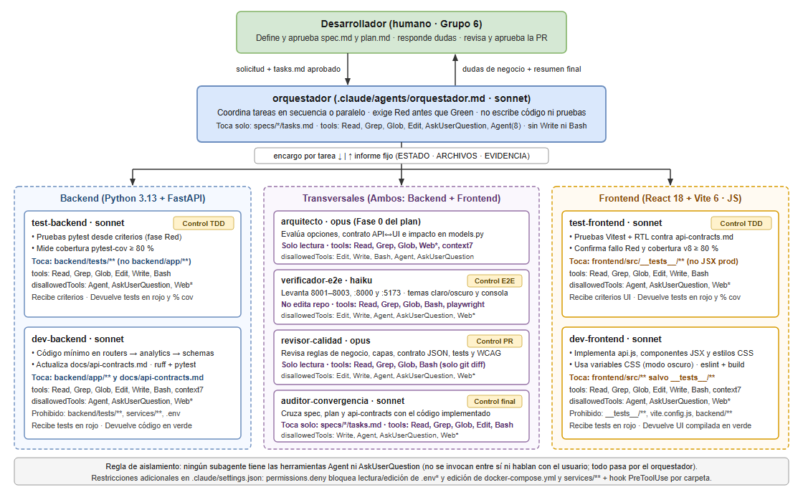
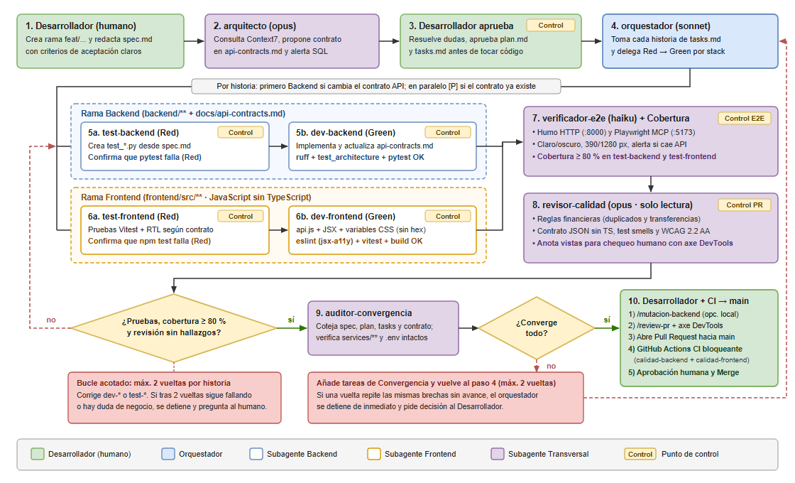

# FinanzIA · Proyecto Integrador: Arnés, Sistema de Agentes y SDD

Diplomado en Ingeniería de Software con IA y Sistemas Agénticos · FET · Grupo 6

**Integrantes:** Angelo David Díaz Cortés · Andrés Ricardo Rodríguez Fernández · Elian Danilo Romero Herrera

**Herramienta del equipo:** Claude Code v2.1.318 (plan Claude Pro), ejecutado desde la terminal de VS Code en Windows con PowerShell.

**Proyecto:** FinanzIA es una aplicación web de finanzas personales construida en un **monorepo** ([`backend/`](backend/) en Python 3.13 + FastAPI + SQLAlchemy 2 y [`frontend/`](frontend/) en React 18 + Vite 6 + Recharts sobre JavaScript sin TypeScript) que consolida, normaliza y deduplica movimientos de tres APIs simuladas ([`services/`](services/)), calcula indicadores con código determinista y los presenta junto a un asistente conversacional de IA que interpreta herramientas sin calcular cifras por su cuenta.

---

## 1. El arnés del proyecto (Parte 1)

El arnés de FinanzIA reúne las piezas que el modelo carga al iniciar sesión, las normas por tipo de archivo, los procedimientos bajo demanda, los roles con permisos separados y las puertas automáticas que verifican cada entrega antes de llegar a `main`.

### 1.1. Piezas del arnés y ubicación en el repositorio

| Pieza | Ubicación exacta | Propósito dentro del proyecto |
|---|---|---|
| **Memoria del proyecto** | [`CLAUDE.md`](CLAUDE.md), [`backend/CLAUDE.md`](backend/CLAUDE.md), [`frontend/CLAUDE.md`](frontend/CLAUDE.md) | Contexto inicial por alcance: importa `@specs/constitution.md` en la raíz, fija comandos desde `.venv`, arquitectura por capas, reglas contables, uso de variables CSS y prohibiciones globales. |
| **Constitución** | [`specs/constitution.md`](specs/constitution.md) | Seis principios no negociables que rigen toda conversación, las especificaciones SDD, las pruebas y las revisiones de código. |
| **Instrucciones / Rules** | [`.claude/rules/backend-python.md`](.claude/rules/backend-python.md), [`.claude/rules/backend-tests.md`](.claude/rules/backend-tests.md), [`.claude/rules/frontend-react.md`](.claude/rules/frontend-react.md), [`.claude/rules/sdd-specs.md`](.claude/rules/sdd-specs.md) | Reglas activadas automáticamente por ruta (`paths:`) solo cuando un agente lee o edita archivos de esa carpeta, cuidando la ventana de contexto. |
| **Skills y comandos SDD** | [`.claude/skills/`](.claude/skills/), [`backend/.claude/skills/`](backend/.claude/skills/), [`frontend/.claude/skills/`](frontend/.claude/skills/) | Diez procedimientos bajo demanda: comandos SDD atómicos (`/interview`, `/sdd-specify`, `/sdd-plan`, `/sdd-tasks`, `/sdd-implement`, `/sdd-flujo-finanzia`), revisión y mutación (`/review-pr`, `/mutacion-backend`) y skills técnicas por capa (detalle en la sección 1.2). |
| **Permisos y hooks** | [`.claude/settings.json`](.claude/settings.json), [`.claude/hooks/guard_agent_paths.py`](.claude/hooks/guard_agent_paths.py) | Fija `CLAUDE_CODE_FORK_SUBAGENT=0`, bloquea lectura/edición de `.env*` y edición de `docker-compose.yml` o `services/**` en `permissions.deny`, y usa el hook `PreToolUse` (`Edit|Write|Bash`) para aislar carpetas por subagente e impedir `git push` o `gh pr merge` automáticos. |
| **Servidores MCP** | [`.mcp.json`](.mcp.json) | Conecta `context7` (consultado solo ante dudas puntuales de APIs nuevas, nunca por rutina) y `playwright` (navegador real para pruebas extremo a extremo). |
| **Sistema de agentes** | [`.claude/agents/*.md`](.claude/agents/) | Un orquestador y ocho subagentes con herramientas mínimas y modelos diferenciados (`sonnet`, `opus`, `haiku`). |
| **Flujo SDD** | [`specs/001-...`](specs/) a [`specs/005-...`](specs/) | Estructura propia de desarrollo guiado por especificaciones con parada humana tras cada artefacto (`spec.md` -> `plan.md` -> `tasks.md` -> implementación orquestada y PR). |
| **Calidad e integración continua** | [`.github/workflows/ci.yml`](.github/workflows/ci.yml), [`backend/tests/test_architecture.py`](backend/tests/test_architecture.py), [`frontend/scripts/check_frontend_guards.mjs`](frontend/scripts/check_frontend_guards.mjs), [`scripts/run_mutation_check.py`](scripts/run_mutation_check.py) | Verificación automática en local y en cada Pull Request hacia `main`. |

### 1.2. Para qué usamos cada skill y cuándo se invoca

| Skill / Comando | Ubicación y origen | Qué problema resuelve en FinanzIA | Cuándo se invoca |
|---|---|---|---|
| [`interview`](.claude/skills/interview/SKILL.md) | `.claude/skills/` · **Propia del grupo** | Explora primero el código y entrevista al desarrollador una duda a la vez con `AskUserQuestion` (recomendación + pros/contras) para no asumir reglas de negocio. | Antes de escribir `spec.md` o cuando `arquitecto` detecta decisiones abiertas en `plan.md`. |
| [`sdd-specify`](.claude/skills/sdd-specify/SKILL.md) · [`sdd-plan`](.claude/skills/sdd-plan/SKILL.md) · [`sdd-tasks`](.claude/skills/sdd-tasks/SKILL.md) · [`sdd-implement`](.claude/skills/sdd-implement/SKILL.md) (índice en [`sdd-flujo-finanzia`](.claude/skills/sdd-flujo-finanzia/SKILL.md)) | `.claude/skills/` · **Propias del grupo** | Proveen un comando `/sdd-*` para cada paso SDD, deteniendo la ejecución tras crear `spec.md`, tras `plan.md` y tras `tasks.md` para aprobación humana antes de delegar el ciclo TDD al orquestador. | En ese orden exacto al desarrollar cualquier funcionalidad nueva en `specs/NNN-nombre/`. |
| [`finanzia-nuevo-endpoint`](backend/.claude/skills/finanzia-nuevo-endpoint/SKILL.md) | `backend/.claude/skills/` · **Propia del grupo** | Evita que un endpoint nuevo mezcle consultas SQL en routers, olvide excluir duplicados o transferencias (`INTERNAL_TRANSFERS` y `SENT_TRANSFERS`) o deje desactualizado `docs/api-contracts.md`. | Cuando `dev-backend` crea o modifica endpoints REST en `backend/app/`. |
| [`vercel-react-best-practices`](frontend/.claude/skills/vercel-react-best-practices/SKILL.md) | `frontend/.claude/skills/` · **Terceros auditada** ([vercel-labs/agent-skills](https://github.com/vercel-labs/agent-skills), MIT, solo Markdown sin scripts ni descargas remotas) | Previene cascadas de red en React agrupando peticiones independientes en `Promise.all` y evitando estados derivados innecesarios en `useEffect`. | Cuando `dev-frontend` implementa vistas o tarjetas en `frontend/src/components/`. |
| [`review-pr`](.claude/skills/review-pr/SKILL.md) | `.claude/skills/` · **Propia del grupo** | Delega el diff `<base>...HEAD` en `revisor-calidad` sin editar código dentro de la skill y propone clasificar cada hallazgo en *Aceptar*, *Cuestionar* o *Descartar* para confirmación humana. | Antes de abrir o fusionar cada Pull Request hacia `main`. |
| [`mutacion-backend`](.claude/skills/mutacion-backend/SKILL.md) | `.claude/skills/` · **Propia del grupo** | Corre pruebas de mutación AST sobre los módulos de cálculo financiero fuera del bucle principal para detectar pruebas débiles sin congelar la sesión de los agentes. | A demanda tras tocar `analytics.py`, `dedup.py`, `categorizer.py` o `normalizer.py`. |

### 1.3. Cómo se usa el arnés paso a paso

1. **Especificar qué y por qué (`/sdd-specify <necesidad>`):** la skill consulta `specs/constitution.md`, aclara dudas con `/interview` (`AskUserQuestion`), abre la rama `feat/NNN-tema`, genera `specs/NNN-tema/spec.md` con criterios verificables (`CA-1`, `CA-2`...) y **se detiene** para que el desarrollador revise y apruebe `spec.md`.
2. **Planificar cómo construirlo (`/sdd-plan`):** con `spec.md` aprobado, delega la Fase 0 al subagente `arquitecto` (`opus`, solo lectura) para definir contratos en `docs/api-contracts.md` e impacto sobre `models.py` (sin Alembic), genera `specs/NNN-tema/plan.md` y **se vuelve a detener** para aprobación humana.
3. **Dividir en tareas TDD (`/sdd-tasks`):** a partir del plan aprobado, genera `specs/NNN-tema/tasks.md` ubicando siempre las tareas **Red** antes de las **Green** por subagente y **se detiene** para que el equipo valide la secuencia antes de tocar código.
4. **Implementar con orquestación (`/sdd-implement` o `claude --agent orquestador`):** el orquestador delega en orden:
   - Pareja backend (`test-backend` en fase Red -> `dev-backend` en fase Green + actualización de `docs/api-contracts.md`) si cambia la API.
   - Pareja frontend (`test-frontend` en fase Red -> `dev-frontend` en fase Green) consumiendo el contrato actualizado.
   - Verificación viva con `verificador-e2e` (`haiku` + Playwright MCP), revisión con `revisor-calidad` (`opus`) y cierre punto por punto con `auditor-convergencia` (`sonnet`), con tope estricto de **2 vueltas** por bucle.
5. **Auditar y fusionar por Pull Request:** se ejecuta opcionalmente `/mutacion-backend`, se corre `/review-pr` para clasificar observaciones, y el desarrollador humano hace `git push`, abre el Pull Request y fusiona en `main` tras pasar en verde GitHub Actions.

---

## 2. Sistema de agentes implementado y cambios respecto al taller (Parte 2)

Los nueve agentes diseñados en el Taller 5 están implementados en [`.claude/agents/`](.claude/agents/):

- **Transversales al monorepo (5):** [`orquestador.md`](.claude/agents/orquestador.md) (`sonnet`), [`arquitecto.md`](.claude/agents/arquitecto.md) (`opus`), [`verificador-e2e.md`](.claude/agents/verificador-e2e.md) (`haiku`), [`revisor-calidad.md`](.claude/agents/revisor-calidad.md) (`opus`) y [`auditor-convergencia.md`](.claude/agents/auditor-convergencia.md) (`sonnet`).
- **Especializados por stack en parejas TDD (4):** [`test-backend.md`](.claude/agents/test-backend.md) (`sonnet`), [`dev-backend.md`](.claude/agents/dev-backend.md) (`sonnet`), [`test-frontend.md`](.claude/agents/test-frontend.md) (`sonnet`) y [`dev-frontend.md`](.claude/agents/dev-frontend.md) (`sonnet`).





### Qué cambió respecto del diseño del Taller 5 y por qué (basado en su uso real)

Al pasar del documento de diseño a la ejecución real sobre las cinco specs en Windows con PowerShell, realizamos **tres ajustes concretos** en el arnés:

1. **Reemplazo de `mutmut` local por un motor determinista de mutación AST multiplataforma (`scripts/run_mutation_check.py`):**
   - *Qué observamos:* en el Taller 5 habíamos previsto correr `mutmut` tanto en la máquina local (PowerShell) como en GitHub Actions. Al probarlo en nuestro entorno real de Windows con Python 3.13 comprobamos que `mutmut` falla al iniciar porque depende de la llamada de sistema `os.fork()`, disponible en Unix/Linux pero inexistente en Windows nativo sin WSL.
   - *Qué cambiamos y por qué:* construimos [`scripts/run_mutation_check.py`](scripts/run_mutation_check.py) usando el módulo estándar `ast` de Python, e integramos su invocación en la skill [`.claude/skills/mutacion-backend/SKILL.md`](.claude/skills/mutacion-backend/SKILL.md) y en el job `mutacion-backend` de CI. Gracias a ese cambio pudimos correr mutación en segundos tanto en Windows como en Linux y descubrir tres pruebas débiles reales (`M-03`, `M-04` y `M-06`) que elevamos de 83.3 % a 95.8 % de mutantes eliminados.
2. **Bloqueo global de `frontend/vite.config.js` y de `git push` / `gh pr merge` en el hook `PreToolUse`:**
   - *Qué observamos:* durante el arranque de las pruebas vimos dos riesgos prácticos: que un subagente tocara `vite.config.js` alterando el proxy `/api` o el puerto `5173`, y que una sesión con acceso a `Bash` intentara publicar ramas o fusionar PRs sin revisión humana previa.
   - *Qué cambiamos y por qué:* añadimos `frontend/vite.config.js` a `ALWAYS_FORBIDDEN_PREFIXES` y ampliamos el matcher de `PreToolUse` a `Edit|Write|Bash` en [`.claude/settings.json`](.claude/settings.json) y [`.claude/hooks/guard_agent_paths.py`](.claude/hooks/guard_agent_paths.py) (verificado automáticamente en [`backend/tests/test_architecture.py`](backend/tests/test_architecture.py)), reservando `git push` y `gh pr merge` al desarrollador humano.
3. **Separación del flujo SDD en comandos atómicos con parada humana (`/sdd-specify`, `/sdd-plan`, `/sdd-tasks`, `/sdd-implement`):**
   - *Qué observamos:* con una única receta general (`sdd-flujo-finanzia`) era fácil caer en escribir prompts manuales repetitivos o en encadenar `spec.md`, `plan.md` y `tasks.md` en una sola corrida sin validar un archivo antes del siguiente.
   - *Qué cambiamos y por qué:* creamos comandos ejecutables independientes apoyados en `/interview` que detienen el flujo al terminar cada documento para que el equipo apruebe primero `spec.md`, luego `plan.md` y después `tasks.md` antes de invocar al `orquestador`.

---

## 3. Cinco specs desarrolladas con SDD (Parte 3)

Utilizamos una **estructura SDD propia y ligera** en [`specs/`](specs/) (sin depender de instalar CLI externos), regida por [`.claude/rules/sdd-specs.md`](.claude/rules/sdd-specs.md) y [`specs/constitution.md`](specs/constitution.md). Cada carpeta `specs/NNN-nombre/` contiene `spec.md` (objetivo y criterios verificables `CA-*`), `plan.md` (decisiones técnicas, contrato HTTP y archivos) y `tasks.md` (pasos por subagente completados en `[X]`).

| Spec | Alcance | Qué se construyó y probó | Artefactos SDD | Pull Request en `main` |
|---|---|---|---|---|
| **001 · Presupuestos mensuales API** | Backend + IA | Modelo `CategoryBudget`, cálculo determinista de ejecución (`ok`, `warning`, `exceeded`) sin duplicados ni transferencias, CRUD `/api/budgets` y herramienta `get_budgets_status`. | [`spec.md`](specs/001-presupuestos-mensuales-api/spec.md) · [`plan.md`](specs/001-presupuestos-mensuales-api/plan.md) · [`tasks.md`](specs/001-presupuestos-mensuales-api/tasks.md) | [#6](https://github.com/angelodiaz2001/finanzIA/pull/6) |
| **002 · Presupuestos mensuales UI** | Frontend | Pestaña interactiva *Presupuestos* ([`BudgetsView.jsx`](frontend/src/components/BudgetsView.jsx)) con carga paralela, formulario accesible y barras de estado con variables CSS para claro/oscuro. | [`spec.md`](specs/002-presupuestos-mensuales-ui/spec.md) · [`plan.md`](specs/002-presupuestos-mensuales-ui/plan.md) · [`tasks.md`](specs/002-presupuestos-mensuales-ui/tasks.md) | [#7](https://github.com/angelodiaz2001/finanzIA/pull/7) |
| **003 · Detección de gastos atípicos** | Backend + IA | Indicador `GET /api/analytics/anomalies` frente al promedio histórico de la categoría (mínimo 3 gastos válidos previos) y herramienta estricta `get_spending_anomalies`. | [`spec.md`](specs/003-deteccion-gastos-atipicos/spec.md) · [`plan.md`](specs/003-deteccion-gastos-atipicos/plan.md) · [`tasks.md`](specs/003-deteccion-gastos-atipicos/tasks.md) | [#8](https://github.com/angelodiaz2001/finanzIA/pull/8) |
| **004 · Totales filtrados y exportación CSV** | Ambos | Subtotales `filtered_income` y `filtered_expenses` sobre todo el filtro activo, endpoint `/api/transactions/export` con UTF-8 BOM + saneamiento de fórmulas CSV y acción en `TransactionsTable.jsx`. | [`spec.md`](specs/004-exportacion-csv-y-totales-filtrados/spec.md) · [`plan.md`](specs/004-exportacion-csv-y-totales-filtrados/plan.md) · [`tasks.md`](specs/004-exportacion-csv-y-totales-filtrados/tasks.md) | [#9](https://github.com/angelodiaz2001/finanzIA/pull/9) |
| **005 · Gastos recurrentes y alertas en Panel** | Ambos | Endpoint `GET /api/analytics/recurring` (>= 2 meses distintos), herramienta IA `get_recurring_expenses` y tarjeta [`RecurringAndAlerts.jsx`](frontend/src/components/RecurringAndAlerts.jsx) integrada en `Dashboard.jsx`. | [`spec.md`](specs/005-gastos-recurrentes-y-alertas-panel/spec.md) · [`plan.md`](specs/005-gastos-recurrentes-y-alertas-panel/plan.md) · [`tasks.md`](specs/005-gastos-recurrentes-y-alertas-panel/tasks.md) | [#10](https://github.com/angelodiaz2001/finanzIA/pull/10) |

 *(Historial previo del Taller 4 conservado en los Pull Requests [#1](https://github.com/angelodiaz2001/finanzIA/pull/1), [#2](https://github.com/angelodiaz2001/finanzIA/pull/2), [#3](https://github.com/angelodiaz2001/finanzIA/pull/3) y [#4](https://github.com/angelodiaz2001/finanzIA/pull/4), y configuración base del arnés en [#5](https://github.com/angelodiaz2001/finanzIA/pull/5)).*

---

## 4. Aseguramiento de la calidad y evidencia verificable (Parte 4)

Implementamos **cinco mecanismos complementarios** aplicados durante las cinco specs, todos verificables directamente en el repositorio y en GitHub:

1. **Integración continua en GitHub Actions con umbral de cobertura >= 80 %:**
   - Configuración: [`.github/workflows/ci.yml`](.github/workflows/ci.yml).
   - Evidencia: ejecuciones en verde de los jobs bloqueantes `calidad-backend` (65 pruebas en `pytest`, **86.3 %** de cobertura sobre `backend.app`) y `calidad-frontend` (11 pruebas de comportamiento en Vitest + React Testing Library, **83.8 %** de cobertura sobre `frontend/src` y build de Vite) en los Pull Requests [#5](https://github.com/angelodiaz2001/finanzIA/pull/5) al [#12](https://github.com/angelodiaz2001/finanzIA/pull/12) y en la pestaña [Actions](https://github.com/angelodiaz2001/finanzIA/actions).
2. **TDD con separación de roles visible en el historial de Git:**
   - Evidencia: en cada Pull Request de las cinco specs ([#6](https://github.com/angelodiaz2001/finanzIA/pull/6), [#7](https://github.com/angelodiaz2001/finanzIA/pull/7), [#8](https://github.com/angelodiaz2001/finanzIA/pull/8), [#9](https://github.com/angelodiaz2001/finanzIA/pull/9) y [#10](https://github.com/angelodiaz2001/finanzIA/pull/10)), el primer commit registra la especificación junto con las pruebas en rojo (`Red`) y el segundo commit incorpora la implementación que las pone en verde (`Green`).
3. **Pruebas deterministas de integridad arquitectónica y guardias estáticas de frontend:**
   - Backend: [`backend/tests/test_architecture.py`](backend/tests/test_architecture.py) analiza el AST de Python para impedir que `analytics`, `dedup`, `normalizer` o `categorizer` importen el SDK `anthropic`, que los routers de indicadores/presupuestos ejecuten SQL directo o que falte `"strict": True` en las herramientas del asistente.
   - Frontend: [`frontend/eslint.config.js`](frontend/eslint.config.js) (`react-hooks` + `jsx-a11y`) y [`frontend/scripts/check_frontend_guards.mjs`](frontend/scripts/check_frontend_guards.mjs) bloquean cualquier llamada a `fetch(` fuera de `src/api.js` y cualquier color hexadecimal fijo `#...` en componentes JSX.
4. **Pruebas de mutación AST con clasificación de supervivientes:**
   - Evidencia: script [`scripts/run_mutation_check.py`](scripts/run_mutation_check.py), pruebas de endurecimiento [`backend/tests/test_mutation_hardening.py`](backend/tests/test_mutation_hardening.py) e informe detallado [`docs/evidencias/reporte-mutacion-backend.md`](docs/evidencias/reporte-mutacion-backend.md) (y [`.json`](docs/evidencias/reporte-mutacion-backend.json)), donde el puntaje subió de **83.3 %** a **95.8 %** (23/24 mutantes eliminados y 1 atajo redundante clasificado).
5. **Revisión estructurada de Pull Requests (`/review-pr`):**
   - Evidencia: comentarios de revisión registrados en los Pull Requests [#5](https://github.com/angelodiaz2001/finanzIA/pull/5), [#6](https://github.com/angelodiaz2001/finanzIA/pull/6), [#7](https://github.com/angelodiaz2001/finanzIA/pull/7), [#8](https://github.com/angelodiaz2001/finanzIA/pull/8), [#9](https://github.com/angelodiaz2001/finanzIA/pull/9) y [#10](https://github.com/angelodiaz2001/finanzIA/pull/10) con las observaciones aceptadas y descartadas antes de cada merge.

---

## 5. Cómo ejecutar y verificar FinanzIA localmente (Windows, PowerShell)

```powershell
# 1. Crear entorno Python 3.13 e instalar dependencias
py -3.13 -m venv .venv
.venv\Scripts\python -m pip install -r backend\requirements.txt -r services\requirements.txt
cd frontend; npm install; cd ..

# 2. Levantar los cinco procesos locales (8001-8003, 8000 y 5173)
powershell -ExecutionPolicy Bypass -File scripts\start_all.ps1

# 3. Ejecutar verificaciones del backend (linter, arquitectura, pruebas y cobertura >= 80%)
.venv\Scripts\ruff check backend services
.venv\Scripts\python -m pytest --cov=backend.app --cov-report=term-missing --cov-fail-under=80

# 4. Ejecutar verificaciones del frontend (eslint + jsx-a11y + guardias + vitest >= 80% + build)
cd frontend; npm run lint; npm run test:coverage; npm run build; cd ..

# 5. Ejecutar auditoría de mutación AST bajo demanda
.venv\Scripts\python scripts\run_mutation_check.py --per-file 6
```

| Componente | URL local |
|---|---|
| Interfaz web (React + Vite) | http://localhost:5173 |
| Backend principal (Swagger) | http://localhost:8000/docs |
| APIs simuladas (banco, billetera, notificaciones) | http://localhost:8001/docs · http://localhost:8002/docs · http://localhost:8003/docs |

Sin archivo `.env` el backend opera con SQLite local y el resto de módulos funciona sin clave de API; para habilitar MySQL 8 en Docker y el asistente con `ANTHROPIC_API_KEY` consulta [`.env.example`](.env.example) y [`docs/api-contracts.md`](docs/api-contracts.md).

## Licencia y uso

Proyecto académico con fines educativos. Todos los comercios, cuentas y movimientos provienen de servicios simulados con datos ficticios.
